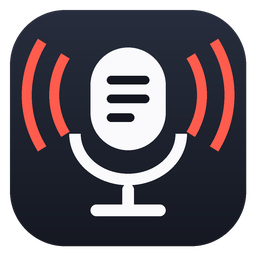
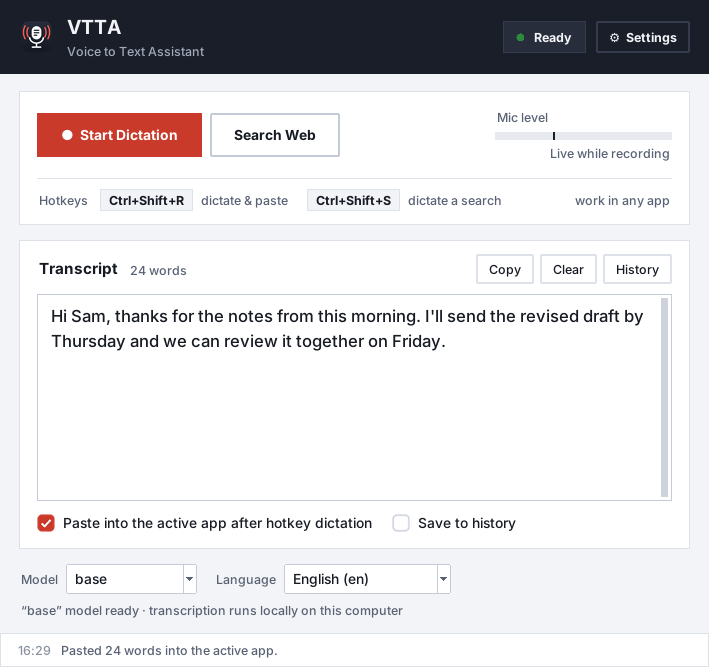

# Voice To Text Assistant (VTTA) 🎤→📝



A lightweight desktop dictation helper for **Windows and macOS** (Linux works too). Press a hotkey, speak, press it again — your words are transcribed **locally** with OpenAI Whisper and pasted where your cursor is. You can also dictate a web search.



## ✨ Features
- **Hotkey dictation anywhere** — `Ctrl+Shift+R` to start/stop, text is pasted into the app you were typing in
- **Dictate a web search** — `Ctrl+Shift+S`, results open in a private window or your default browser
- **Start Dictation button** — records until you pause, then shows the text in the window
- **Clear feedback** — status badge, live mic level, a small on-screen indicator while recording/transcribing, and very quiet sound cues (adjustable or off)
- **Runs offline** — speech never leaves your computer (unless you turn on optional voice commands)
- **Low profile** — nothing polls while idle; the microphone is opened only while you record; the model can free its memory after a period of inactivity
- **Portable** — settings, history, models and the optional private browser all live in one folder next to the script
- **History (optional)** — searchable, stored locally in SQLite; off by default
- **Launch at sign-in** (Windows, macOS, Linux) and a tray icon (Windows/Linux) or Dock icon (macOS)

## 🚀 Quick start (one download)
**1. Download the file for your computer:**

| Windows | macOS | Linux |
|---|---|---|
| [**VTTA-Windows.zip**](https://github.com/CtrlAltDefeat55/Voice_To_Text_Assistant-VTTA/releases/latest/download/VTTA-Windows.zip) | [**VTTA-macOS.zip**](https://github.com/CtrlAltDefeat55/Voice_To_Text_Assistant-VTTA/releases/latest/download/VTTA-macOS.zip) | [**VTTA-Linux.zip**](https://github.com/CtrlAltDefeat55/Voice_To_Text_Assistant-VTTA/releases/latest/download/VTTA-Linux.zip) |

**2. Unzip it anywhere.** You get a tidy **VTTA** folder. The launcher's name says which system it's for, so there's nothing to guess:

| Windows | macOS | Linux |
|---|---|---|
| `VTTA/Start VTTA (Windows).bat` | `VTTA/Start VTTA (Mac).command` | `VTTA/Start VTTA (Linux).sh` |

```
VTTA/
  Start VTTA (Windows).bat     ← the only thing you need to open
  Read Me First.txt            short instructions for your system
  app/                         the program; its settings and private Python live here too
    Troubleshoot VTTA (Windows).bat   options menu (see below)
```

**3. Open your `Start VTTA (...)` file.**
- **Windows:** double-click it. If SmartScreen warns, choose **More info → Run anyway**.
- **Mac:** double-click it. The very first time, macOS blocks downloaded scripts, so right-click it, choose **Open**, then **Open** again.
- **Linux:** run `./"Start VTTA (Linux).sh"`.

The **first start** sets everything up inside the folder. It needs internet, downloads about 1 GB, and takes a few minutes:
- It finds Python 3.10–3.13. On Windows it offers to install Python 3.12 for you if it's missing.
- It creates a private environment and installs the components.
- On Windows it offers a desktop shortcut with the VTTA icon.

After that, the same file opens VTTA right away.

**Updates:** VTTA checks once a day whether a newer version is out. When one is, an **Update to x.y** button appears in the status bar. One click downloads it, checks it against its published checksum, installs it (including the launchers), keeps your settings, history and models, and restarts VTTA. You can also use **Help → Check for Updates…**, or turn the daily check off in **Settings → General**.

**Options & troubleshooting:** open `app/Troubleshoot VTTA (...)` or use **Help → Troubleshooting & Options…** inside VTTA. A numbered menu lets you:

| Option | When to use it |
|---|---|
| Start VTTA | normal start |
| Start VTTA and show its messages | VTTA won't open, or you want to report a problem |
| Repair VTTA | reinstall its components (fixes most setup problems) |
| Create a desktop shortcut | Windows only; adds VTTA with its icon to the desktop |
| Open the VTTA folder | find its files |
| Free disk space | remove the ~1 GB of components; they're set up again on the next start |

Power users can pass `menu`, `debug` or `setup` to the Start file directly.

**Move or uninstall:** keep the folder together, and move it whenever you like. To uninstall, turn off **Launch at sign-in** in Settings if you used it, then delete the folder. Nothing else is left behind.

Using the **Code → Download ZIP** copy instead? It contains all three Start files. Open the one for your system and it hides the other two.

### Platform notes
- **macOS:** the launcher installs PortAudio with [Homebrew](https://brew.sh) if Homebrew is present (it's needed to build PyAudio). If Homebrew isn't installed, install it first and run `brew install portaudio`. Use Python from python.org; Homebrew Python also works if `python-tk` is installed.
- **macOS permissions:** on first use, allow **Terminal** under **System Settings → Privacy & Security**:
  - **Microphone** — to record
  - **Accessibility** and **Input Monitoring** — for the global hotkeys and pasting

  Then start VTTA again.
- **Linux:** you may need `sudo apt install python3-venv python3-tk python3-dev portaudio19-dev xclip`. The `keyboard` package needs root for global hotkeys; without it, use the window's buttons.
- **FFmpeg is not needed.** The first dictation downloads the Whisper model you picked (`base` ≈ 140 MB) into `VoiceFlow_App_Files/models`. If you already have it in Whisper's shared cache, it's copied instead of downloaded.

### Manual setup (developers)
```bash
python -m venv .venv
# Windows: .venv\Scripts\activate     macOS/Linux: source .venv/bin/activate
pip install -r requirements.txt
python Voice_To_Text_Assistant.py
```
Build the release packages yourself with `python tools/build_release.py`. It writes `VTTA-Windows.zip`, `VTTA-macOS.zip`, `VTTA-Linux.zip` and `SHA256SUMS.txt` to `dist/`.

To publish a release:
1. Bump `APP_VERSION` in `Voice_To_Text_Assistant.py` on `main`.
2. On GitHub, open **Actions → Release package → Run workflow**, tick **publish**, and run it. It builds the packages, creates the `vX.Y` tag, and publishes the release with download instructions. Pushing a matching `vX.Y` tag does the same.
3. Installed copies offer the update the next day, or right away via **Check for Updates**.

## ⌨️ Using it
| Action | How |
|---|---|
| Dictate & paste | `Ctrl+Shift+R`, speak, `Ctrl+Shift+R` again |
| Dictate a web search | `Ctrl+Shift+S`, speak, `Ctrl+Shift+S` again |
| Switch what happens | Stop with the *other* hotkey (start with R, stop with S → search) |
| Record in the window | **Start Dictation** — stops automatically when you pause |
| Throw a recording away | **Discard** (appears while recording) |
| History / Settings / Quit | `Ctrl+H` / `Ctrl+,` / `Ctrl+Q` (`Cmd` on macOS) |

Change hotkeys in **Settings → General** (click **Record** and press the keys).

If recording stops too early or never stops on its own, adjust **Settings → Recording → Silence threshold**. The dark tick on the mic-level meter shows where it is.

## ⚙️ Settings at a glance
- **General** — hotkeys, sound cues and click sounds with volume and a Test button, recording-indicator position, close-to-tray/Dock, start minimized, launch at sign-in
- **Recording** — microphone choice (listed only when you open Settings or click Refresh), auto-stop pause length and threshold, longest recording, free model memory after N idle minutes
- **Web Search** — private Playwright window or your default browser, install the private browser into the app folder, custom Chromium browser, auto-close timer
- **Advanced** — optional Google voice commands, hotkey timing and indicator timing

## 🗂️ What VTTA stores (all inside the app folder)
```
Start VTTA (Windows).bat     launcher (one per system; in the app/ folder's parent for release downloads)
Voice_To_Text_Assistant.py
assets/                      icon
.venv/                       private Python environment (created on first start)
VoiceFlow_App_Files/
  config.json                settings
  history.db                 only if "Save to history" is on
  models/                    Whisper models you've used
  browsers/                  only if you install the private browser here
start_minimized.bat          Windows only, created when "Launch at sign-in" is on
```
- No log files, temp recordings or caches are written. Problems from the current session are kept in memory (**Tools → Diagnostics**) and cleared on exit.
- The only thing outside the folder is the sign-in entry you opt into: Windows Startup shortcut, macOS LaunchAgent, or Linux autostart file.
- You can move or rename the whole folder. On the next launch VTTA repoints its sign-in entry to the new location. The launcher checks `.venv` on every start and rebuilds it if a move broke it.
- Older versions wrote `VoiceFlow_App_Files/error.log` and `temp_recording.wav`. VTTA no longer creates them, and you can delete them.

## 🛠️ Troubleshooting
- **`pyaudio` install fails** — Windows: `pip install pipwin && pipwin install pyaudio`. macOS: `brew install portaudio`. Linux: `sudo apt install portaudio19-dev`.
- **Hotkeys do nothing** — the hotkey row in the window says why. On macOS grant Accessibility + Input Monitoring. **Tools → Reload Hotkeys** re-registers them.
- **Private search window won't open** — **Settings → Web Search → Install into app folder**, or choose **My default browser**.
- **Something failed** — click **Details** in the status bar (or **Tools → Diagnostics**) and use **Copy All** when reporting an issue.

## 🔐 Privacy
- Audio is recorded only while you dictate, kept in memory, and never saved to disk.
- Transcription runs locally. **Voice commands** (off by default) keep the microphone open and send short clips to Google's online recognizer.
- Pasting uses the clipboard and simulates `Ctrl/Cmd+V` — only after hotkey dictation, and only when **Paste into the active app** is on.
- The daily update check is one request to `api.github.com` with no personal data. Turn it off in **Settings → General**.

See [`SECURITY.md`](./SECURITY.md).

## 🤝 Contributing
See [`CONTRIBUTING.md`](./CONTRIBUTING.md). Code of conduct: [`CODE_OF_CONDUCT.md`](./CODE_OF_CONDUCT.md).

## 📄 License
From version 2.0, VTTA is licensed for **noncommercial use only** under the [PolyForm Noncommercial License 1.0.0](./LICENSE). Personal use, study, hobby projects and use by noncommercial organizations are fine. Commercial use needs separate permission from the author. Releases before 2.0 were published under the MIT License.
